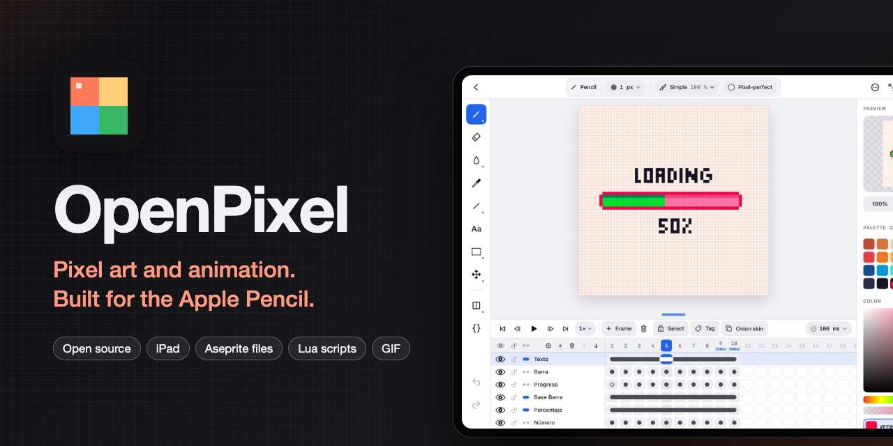

<p align="center"></p>

# OpenPixel

An **open source** pixel art and animation editor for iPad, built for Apple Pencil.

[Español](README.es.md)

📖 **User manual**, in English and Spanish: <https://rldona.github.io/OpenPixel/> (source in [`manual/`](manual/)).

It pairs the clean interface of [Pixaki](https://pixaki.com/) with the working model of [Aseprite](https://www.aseprite.org/docs/): a sprite has **layers** and **frames**, and the image at each layer × frame intersection is a **cel**.

> Status: early (0.1). It covers [Aseprite's Basics](https://www.aseprite.org/docs/basics/) plus tags, drawing tools and a GPU-backed canvas.

## Features

- **Projects** gallery with thumbnails (animated sprites play in a loop, unless Reduce Motion is on), search, filters (all, animations, still images), rename, duplicate, delete, and PNG/GIF/JPEG import.
- **New sprite**: quick sizes (16–256) or custom up to 1024 px, transparent, white or black background, and a starting palette (PICO-8, Sweetie 16, DawnBringer 16, grays).
- **Editor**
  - Pencil, **spray** (⇧S), eraser, paint bucket, **gradient**, eyedropper, line, **curve**, rectangle, ellipse, **contour** and **polygon** (as in [Aseprite](https://www.aseprite.org/docs/drawing/)).
    - Curve: drag the line, then drag twice to bend each end. Polygon: tap each corner and tap the first one (or Done) to close it. Contour: draw an outline and it fills when you lift. Gradient (⇧G, with the bucket): drag across the area the bucket would fill to blend the primary into the secondary color, linear or radial, smooth or with 2×2, 4×4 or 8×8 Bayer dithering. Control points and corners are marked on the canvas.
  - The top bar holds back, the active tool's options (a fixed-width strip that scrolls when a tool has more options than fit), the Edit menu, focus mode, grid and tiled mode, and Export. Undo and redo sit at the bottom of the tool rail; the project's name (tap to rename) and the zoom are at the top of the side panel, above the preview.
  - Tool options:
    - square, round or **line** brush (at any angle, in 15° steps) from 1 to 32 px; every number in the options bar opens a panel with common values, a slider, large −/+ buttons and a field to type it;
    - **custom brush**: select part of the drawing and choose Edit > New brush from selection (⌘B) to paint with it, in its own colors or in the primary color;
    - spray width and speed;
    - optional pixel-perfect for clean 1 px strokes (off by default; the choice is remembered);
    - filled or outlined shapes, previewed while you drag, and rounded rectangle corners;
    - paint bucket: contiguous or global, tolerance, diagonals (8-way spreading) and “All layers” to find the area from every visible layer while painting only the active one;
    - eyedropper: the whole image or the active layer only;
    - when a tool has more options than fit, the bar scrolls sideways.
  - **Symmetry** ([Aseprite's](https://www.aseprite.org/docs/symmetry/)): horizontal, vertical or both. Tap the rail button to turn it on or off; touch and hold to choose the axes or center them. Drag an axis by its handle (below or right of the sprite) to move it in half-pixel steps, so it can run between two pixels or through the middle of one.
  - **Tiled mode** (Aseprite's View > Tiled Mode, the button next to the grid): the sprite is shown repeated around itself, horizontally, vertically or both, and strokes, shapes and fills wrap across the edges, to make seamless textures.
  - Apple Pencil Pro **squeeze** swaps the primary and secondary colors (Aseprite paints with the secondary color on right-click).
  - **Inks** ([Aseprite's](https://www.aseprite.org/docs/ink/)): simple, alpha compositing, copy alpha + color, lock alpha (paint only over what's drawn) and shading (each pass moves drawn pixels to the next or previous palette color). Tool **opacity**, applied once per stroke so going over the same spot doesn't build up.
  - **Apple Pencil pressure** can change the brush size and/or the opacity.
  - Pixel grid, whole-number zoom levels and fit to screen.
  - **Grid** (touch and hold the # button): a grid of any cell size and offset, saved with the sprite, drawn over the canvas. **Snap to grid** makes marquees take whole cells and moves go cell by cell; the paint bucket can **stop at the grid** lines.
- **Selection** (as in [Aseprite](https://www.aseprite.org/docs/selecting/))
  - Rectangular and elliptical marquee, lasso and magic wand (tolerance, contiguous, current layer or all layers).
  - Replace, add, subtract and intersect modes, chosen in the tool options instead of Shift/Alt.
  - Select all, deselect, reselect, invert, select layer content, and expand, contract or border.
  - Marching ants. Drawing, filling and erasing stay inside the selection.
  - Cut, copy, paste (also images from other apps), delete and fill with the primary color.
- **Transform** (as in [Aseprite](https://www.aseprite.org/docs/transformations/))
  - Move, scale (drag past an edge to flip), rotate around a movable pivot, with RotSprite or fast rotation, keep aspect and 15° angle snapping.
  - Flip and rotate 90° the selection or, with nothing selected, the whole cel. Duplicate and move.
  - Apply, cancel, or tap outside to apply. The whole transform is one undo step.
  - Canvas: crop to selection, trim empty space, rotate and flip.
  - Undo and redo (up to 100 steps).
- **Aseprite-style timeline**, compact like Aseprite's: drag the grab bar on its top edge to make it taller or shorter (double tap it to fit every layer); keep pushing down and it hides behind a small capsule with play, the frame number and a scrubber, as in Calco (tap its arrow or drag it up to bring the timeline back). The same capsule shows in focus mode, where its button leaves focus mode. It keeps the layer you're working on in view, and the tag rows only appear once the sprite has tags.
  - Layers: show/hide, lock, rename, opacity, delete and drag to reorder. The eye, lock and continuity icons in the header act on every layer at once.
  - **Background layer**, as in Aseprite: opaque, underlined, always at the bottom, and erasing or clearing leaves the secondary color. Convert a layer to the background and back from its menu.
  - Frames: “+ Frame” duplicates the current frame; touch and hold for an empty one. Drag a frame number to reorder, delete, and set each frame's duration: −/+, presets up to 4 s, or type any value up to 65 535 ms. Frames that last longer or shorter than most show their duration under the frame number.
  - **Tags**: named, colored frame ranges with a direction (forward, reverse, ping-pong, ping-pong reverse) and a repeat count.
  - **Playback** of the current frame's tag (or all frames) at 0.25× to 3× speed, with first, previous, next and last frame buttons (Home and End on a keyboard).
  - **Linked cels**: cels that share one image, so editing one changes all of them, drawn as one long pill in the timeline. Mark a layer as **continuous** (●● turns into ▬) and new frames link its cel instead of copying it. Unlink from the cel's menu.
  - **Range selection**: tap “Select”, then cels, frame numbers or layer names to select a block, and link, unlink, clear, duplicate, reverse or delete it.
  - **Move and copy blocks** of cels, frames or layers by dragging them, as in Aseprite. A switch next to “Done” chooses between moving and copying. Blocks dropped past the last frame add frames, and copies on a continuous layer are linked to their originals.
  - **Copy and paste between sprites**: copy a block, then paste cels, frames or layers from the menu of a cel, a frame number or a layer in any sprite.
  - **Loop section**, new tags over the selected frames and duration for several frames at once. **Focus a tag band** so playback stays inside its tags.
  - **Reference layers**, as in Aseprite: touch and hold the timeline's + to add one from Photos or Files. The image keeps its own resolution (it isn't turned into pixels; photos are stored at up to 2048 px), starts at 50 % opacity under the drawing (or over it, if no drawn layer is above), can't be painted on and isn't exported. Move it with the Move tool; fit, fill, enlarge or shrink it from its menu.
  - **Layer groups**: group a layer from its menu, several from a timeline layer selection, or create one from the + menu. Groups fold with their chevron; their visibility, lock and opacity apply to everything inside; moving, duplicating or deleting a group takes its layers along. Move layers into a group or take them out from their menu; a new layer added on a group goes inside it.
  - **Blend modes** per layer (from its menu): normal, multiply, screen, overlay, darken, lighten, color dodge and burn, hard and soft light, difference, exclusion, addition, subtract and divide. Merging down keeps the look.
  - **Merge down** and **flatten** (from a layer's menu), **new layer from selection** (⌘J, or ⌘⇧J to cut), and an **animated preview** in the side panel with its own play button, so the animation runs while you draw.
  - **Cel opacity** (shared by linked cels), duplicate layer, double tap to rename, first frame numbered 0 or 1, and Aseprite's keys: `,` `.` for previous/next frame and ⇧X to show or hide the layer.
  - Configurable **onion skin**: 0–3 frames before and after, opacity, red/blue tint, and an option to stay inside the tag.
- **Smart selection**: with the marquee or lasso, tap a drawn element to select exactly its pixels; its layer becomes active (the topmost visible layer under your finger). Add mode collects several elements. A marquee or lasso takes every visible layer under it (or the layers selected in the timeline) and fits the drawn pixels inside it (switchable with “Fit to content”); over empty canvas it keeps its shape. Moving, transforming, deleting, filling (each layer recolors its own pixels) and cutting that selection changes all those layers; copying copies them merged. Turn on “All frames” to apply all of it to every frame of the animation.
- **Move without switching tools**: with a selection tool, drag inside the selection to move its pixels (with scale and rotate handles); drag outside to select again. **Transforms follow the timeline selection**: with several cels, layers or frames selected in the timeline, moving, scaling, rotating or flipping changes all of them, as in Aseprite.
- **Text tool** (T): tap the canvas and type. Two built-in pixel fonts (5×7 with lowercase and accents, and 3×5 capitals) at whole-pixel scales, or system fonts drawn without smoothing. Letter and line spacing, alignment and a 1 px outline in the secondary color. The text lands as floating pixels you can move, scale or rotate before applying.
- **Color and palettes**, as in Aseprite:
  - Color editor with a spectrum, RGB and HSB sliders, hex, opacity, shades and harmonies (complementary, analogous, triadic…), and a warning with “add to palette” when the color isn't in it.
  - Primary and secondary colors (marked on the palette), swap, and **Replace color** (⇧R) with tolerance, in the current cel or every cel, inside the selection.
  - Palette editing: select a run of colors to edit, gradient, reverse, sort (hue, saturation, brightness, luminance), duplicate, delete and drag to reorder. Everything can be undone.
  - Presets (DawnBringer 32, PICO-8, Sweetie 16, Endesga 32, DawnBringer 16, Game Boy, grays), palette from the sprite's colors, import (.gpl, .hex, .pal, .txt, .png, .gif) and export (.gpl, .hex), and a default palette for new sprites.
- **Tilemaps** ([Aseprite's](https://www.aseprite.org/docs/tilemap/)): add a tilemap layer from the timeline's + menu (its tiles take the grid's cell size) or convert a layer from its menu. Its tileset shows in the side panel. Draw **pixels** in the three tileset modes — manual (editing a cell edits its tile, so every copy changes), auto (each edited cell gets a matching tile, new or reused, and unused tiles go away) and stack (each edit gets a new tile) — or place **tiles**: the pencil places the selected tile, the eraser clears cells, the bucket fills connected cells and the eyedropper picks a tile. The tileset can be exported as a PNG strip; tilemaps convert back to normal layers.
- **Slices** ([Aseprite's](https://www.aseprite.org/docs/slices/), ⇧C, with the Move tool): drag to draw a named, colored rectangle; drag inside to move it or an edge or corner to resize it, tap another to pick it. Each slice can have a 9-slice center and a pivot, edited from its properties; changes on a later frame add a key there so slices can follow the animation. Exported as one PNG per slice or in the sprite sheet's JSON.
- **Export**: PNG of the current frame, sprite sheet (optionally with Aseprite's JSON data: frames, durations, tags and slices, for game engines), animated GIF or one PNG per slice, at 1×–10× with nearest-neighbor scaling. Sprite sheets and GIFs can be limited to one tag, and GIFs follow the tag's direction and repeat count. Files are shared through the iOS share sheet.
- **Autosave** to `Documents/Sprites` (visible in the Files app), as readable `.openpixel` JSON. Saving runs in the background.
- **Preferences**: English (default) or Spanish, light, dark or system appearance, and the accent color (ember, blue, green, purple or pink). Editor preferences after [Aseprite's](https://www.aseprite.org/docs/preferences/): checkerboard size and colors, grid colors, alpha shown as 0–255 or %, rewind on stop, undo steps, what a finger, a Pencil double tap and a squeeze do, and a mirrored layout for left-handers (tools on the right).
- **Scripts** ([Aseprite's](https://www.aseprite.org/docs/scripting/), Lua 5.4): add `.lua` scripts from Files and run them from … > Scripts. They see a subset of Aseprite's API — `app`, `Sprite`, `Layer`, `Cel`, `Frame`, `Image`, `Color`, `Palette`, `Point`, `Rectangle` and `Dialog`, shown as a floating window — so pixel scripts like [Isometric Box](https://darkwark.itch.io/isobox-for-aseprite) run as they are. Each run is one undo step. Scripts can't reach files or the network, and a script that needs a part of the API OpenPixel lacks stops and names it.
- **Extensions** ([Aseprite's](https://www.aseprite.org/docs/extensions/)): `.aseprite-extension` packages add their palettes, dithering matrices and scripts. Plugin commands (`plugin:newCommand`) show in … > Scripts, and plugins can listen to events (`sprite.events`, `app.events`), use timers, selections and `plugin.preferences`, so extensions like [Magic Pencil](https://github.com/thkwznk/aseprite-scripts/tree/master/Magic%20Pencil) work: what they change after a stroke joins that stroke's undo step.
- Full-screen editing with no status bar, and a focus mode that leaves only the canvas.

## Performance

Drawing stays smooth on large canvases (256×256 and up):

- the canvas is made of Core Animation layers, so zooming and panning are done by the GPU;
- while you draw, only the pixels a stroke touched are recomposited, and the rest of the UI updates once, when the stroke ends;
- all Apple Pencil samples of a touch event are processed as one batch.

`PerformanceTests` prints the cost per Pencil event. Profile **Release** builds: unoptimized Debug builds are about 100× slower in the pixel loops.

## Gestures

| Gesture | Action |
|---|---|
| Apple Pencil | Draw with the current tool |
| One finger | Draws until the Pencil is used; after that, fingers only navigate |
| Pinch / two fingers | Zoom and pan |
| Two-finger tap | Undo |
| Three-finger tap | Redo |
| Touch and hold (with Pencil) | Quick eyedropper |
| Double-tap on the Pencil | Toggle eraser and previous tool |
| Squeeze the Apple Pencil Pro | Swap primary and secondary colors |
| Four-finger tap | Focus mode: hide or show the panels |

With a keyboard, OpenPixel uses Aseprite's shortcuts:

| Key | Action |
|---|---|
| `B` / `⇧S` | Pencil / spray |
| `E` | Eraser |
| `G` / `⇧G` | Paint bucket / gradient |
| `I` | Eyedropper |
| `L` / `⇧L` | Line / curve |
| `D` / `⇧D` | Contour / polygon |
| `U` / `⇧U` | Rectangle / ellipse |
| `[` `]` | Brush size |
| `M` / `⇧M` | Rectangular / elliptical marquee |
| `Q` | Lasso |
| `W` | Magic wand |
| `V` / `⇧C` | Move / slice |
| `⌘A` / `⌘D` / `⇧⌘D` | Select all / deselect / reselect |
| `⇧⌘I` | Invert selection |
| `⌘X` `⌘C` `⌘V` | Cut, copy, paste |
| `⌘T` | Transform |
| `⌘B` | New brush from selection |
| `⇧H` / `⇧V` | Flip horizontally / vertically |
| `↩` / `⎋` / arrows | While transforming: apply / cancel / nudge 1 px |
| `↩` / `⎋` | While building a curve or polygon: done / cancel |
| `X` | Swap colors |
| `⌥N` | New frame (duplicates the current one) |
| `⌥⇧N` | New empty frame |
| `⇧N` | New layer |
| `⌥⌘T` | New tag |
| `↩` | Play |
| `←` `→` | Previous / next frame |
| `⌘Z` / `⇧⌘Z` | Undo / redo |
| `⇥` (Tab) | Focus mode |

## Building

Requirements: Xcode 16 or later, [XcodeGen](https://github.com/yonaskolb/XcodeGen), iPadOS 17 or later.

```bash
brew install xcodegen
cp Config/Local.xcconfig.example Config/Local.xcconfig   # set your DEVELOPMENT_TEAM
xcodegen generate
open OpenPixel.xcodeproj
```

`OpenPixel.xcodeproj` is generated from `project.yml` and isn't committed.

Tests:

```bash
xcodebuild test -project OpenPixel.xcodeproj -scheme OpenPixel -destination 'platform=iOS Simulator,name=iPad Pro 11-inch (M5)'
```

## Project layout

```
OpenPixel/
  App/         Entry point, theme, preferences
  Model/       Sprite, layers, frames, cels, tags, colors, palettes, rasterization
  Document/    SpriteDocument (editing state + undo) and storage
  Files/       .aseprite files, extensions and the ZIP reader
  Scripting/   The Lua script engine and the Aseprite API it offers
  Rendering/   CGImage conversion and PNG/GIF export
  Views/       Gallery, new sprite, editor (UIKit canvas, timeline, panel), export, preferences
  Resources/   Assets and localizations (en, es)
OpenPixelTests/
Vendor/Lua/    Lua 5.4 (MIT), core and safe libraries only
manual/        The user manual (VitePress), published to GitHub Pages
Assets/        The repository cover (scripts/make-cover.sh renders it)
```

## Contributing

Contributions are welcome. Please write code, comments, commit messages, issues and pull requests in **English**.

- Any new UI text uses an English key. Add its Spanish translation to `OpenPixel/Resources/es.lproj/Localizable.strings`.
- Run the tests before opening a pull request.

## Roadmap

- Indexed and grayscale color modes
- More of Aseprite's scripting API (tags, slices, tilesets, more `app.command`s)

## License

[MIT](LICENSE)
